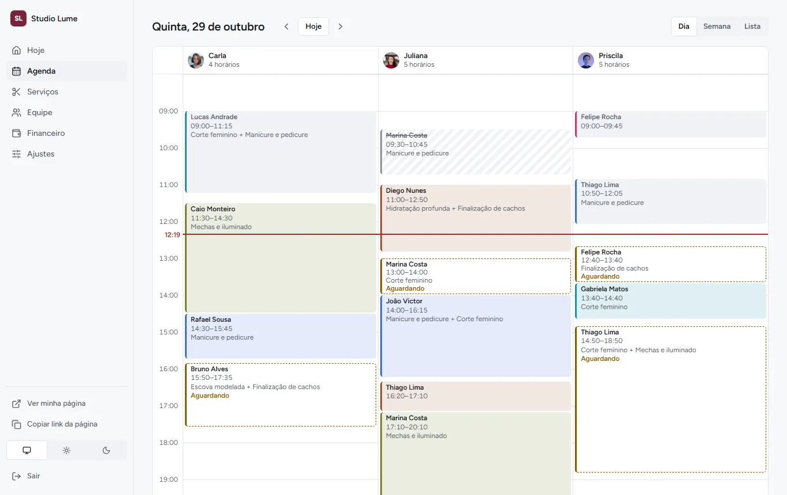

# 10 · Interface final (fase 11)

Implementação no app React da combinação escolhida na fase 10:

| Superfície | Direção | Referência |
|---|---|---|
| Página pública (`/<slug>`) | **B · Vitrine** (Fresha, Booksy) | Foto grande, pílulas, sombras macias |
| Painel do dono (`/dashboard`) | **A · Calmo** (Linear, Cal.com) | Denso, linhas de 1 px, menu enxuto |

Branch `fase-11-implementacao-visual`, empilhada sobre a `fase-10-direcoes-visuais`. Não foi mesclada
na main.




Os 28 screenshots (WebP, 1,9 MB) estão em [`screenshots/`](screenshots/). Para gerar de novo, siga
o cabeçalho de [`screenshots/capturar.cjs`](screenshots/capturar.cjs).

## O que mudou

### Fundação: um design system, duas superfícies

- **Tokens:** cor, tipografia, espaço, estados e movimento ficam em `styles/tokens.css`. A classe
  `.sup-vitrine` troca só os tokens de forma (raios, sombras, corpo de 15 px). Documentação em
  [`design/sistema.md`](design/sistema.md).
- **Fonte:** uma só família, Figtree variável auto-hospedada (20 KB, latino, `font-display: swap`).
  Ela substituiu Bricolage e Atkinson, que somavam 66 KB.
- **Cor da empresa:** `variaveisDestaque(hex, tema)` gera preenchimento, texto sobre a cor, cor como
  texto, tom suave e o fim do gradiente da capa. O contraste AA é garantido nos dois temas para
  **qualquer** cor, inclusive cinza médio, branco e preto, e os testes cobrem esses casos. O hook
  `useCorEmpresa` recalcula tudo a cada troca de tema.
- **Componentes em `components/ui`:** Campo, Cartao, Avatar, ChipHorario, EstadoVazio, Skeleton,
  Segmento, Selo e CampoImagem. Botão, modal e toast foram adaptados às superfícies.
- **Catálogo** em `/_catalogo`: só existe no `npm run dev`, porque o Vite remove a rota e o chunk do
  build.

### Página pública (Direção B)

- **Capa:**
  - **Com foto:** imagem de ponta a ponta em `srcset` (640/1024/1600, 16:9) com
    `fetchpriority="high"`.
  - **Sem foto:** gradiente da cor da empresa, com as iniciais em marca-d'água.
  - **Logo:** a foto enviada ou as iniciais.
- **Serviços:** cartões com foto grande (2 colunas no celular, 3 no desktop), duração sobre a foto,
  "Adicionar / ✓ Adicionado" e "Ver mais" (descrição, fotos, vídeo e YouTube).
  - Se menos da metade dos serviços tem foto, a vitrine vira uma **lista compacta**, com um quadro
    na cor da empresa e as iniciais do serviço. Assim a página não fica "vazia".
- **Equipe:** retratos com foto ou iniciais.
- **Dias e horários:** dias em cartões e horários em pílulas, agrupados em Manhã, Tarde e Noite.
  "Hoje" já vem escolhido.
- **Sua visita:** barra fixa no rodapé do celular, que sobe ao escolher o primeiro serviço. No
  desktop é um cartão fixo ao lado. É uma única região acessível com um único botão.
- **Seus dados:** no mesmo padrão de cartão, com os campos do design system.
- **Estados cobertos:**
  - carregando (skeleton);
  - não encontrada;
  - **empresa suspensa** (a API agora responde 410 com `codigo: empresa_suspensa`);
  - erro de rede, com "Tentar de novo";
  - sem serviços;
  - dia fechado e dia sem horários;
  - horário tomado por outra pessoa (o aviso aparece e a grade recarrega);
  - confirmação.

### Back-end (o mínimo para as fotos da Direção B)

- **Campos novos:** `Empresa.capa_public_id`, `Empresa.logo_public_id` e
  `Profissional.foto_public_id` (migration 0012).
- **Upload:** usa o mesmo fluxo assinado da vitrine. O arquivo chega privado, é validado pelo
  conteúdo e só então vira público. A imagem antiga é apagada depois do commit, e as fotos são
  apagadas junto com a empresa ou o profissional.
  - **Empresa:** `POST|DELETE /empresa/{id}/capa|logo/` e `…/assinatura/`.
  - **Profissional:** `/profissionais/{id}/foto/`.
- **Lista de serviços do dono:** traz `capa_url` e `total_midias` (com prefetch só na listagem).

### Painel (Direção A)

- **Menu:** Hoje, Agenda, Serviços, Equipe, Financeiro e Ajustes. No celular são 3 abas + Mais.
  - **Rotas antigas redirecionam:** `/dashboard/profissionais` → Equipe,
    `/dashboard/horarios` → Equipe (aba Horários) e `/dashboard/configuracoes` → Ajustes.
- **Hoje:**
  - números do dia;
  - "A seguir", com quanto falta e "agora" na cor da empresa;
  - "Esperando sua confirmação", com confirmar direto;
  - resumo da semana em barras;
  - atualização a cada minuto.
- **Agenda:**
  - **Dia:** uma coluna por profissional.
  - **Semana:** cada dia dividido em faixas, uma por profissional.
  - Cores por serviço, linha do "agora", legenda e navegação ‹ Hoje ›.
  - **Lista:** reaproveita a página antiga (filtros, polling, cartões com anexos).
  - **Corrigido:** o título da visão Semana agora mostra o intervalo ("26 de outubro a 1º de
    novembro"), e não o dia.
- **Detalhe do horário:** sheet com serviços, total, profissional, telefone, confirmar, cancelar
  (com confirmação), WhatsApp e fotos e vídeos do atendimento.
- **Serviços:** miniatura e contagem da vitrine. O estado vazio diz "Cadastre seu primeiro serviço".
- **Equipe:** profissionais com foto (enviada no modal de edição) e a grade de horários na outra
  aba.
- **Financeiro:** barras na cor da empresa e a mesma paleta de serviços da Agenda.
- **Ajustes:** nova seção "Sua página pública", com a cor da empresa (antes não havia seletor no
  painel), a capa e a logo. Privacidade e LGPD (exportar dados e excluir conta) continuam no mesmo
  lugar.
- **Login e cadastro:** na linguagem da A, com `<main>`.

### Modo demonstração (novo)

```bash
cd backend
MIDIA_PROVEDOR=local DATABASE_URL=sqlite:///demo.sqlite3 python manage.py migrate
MIDIA_PROVEDOR=local DATABASE_URL=sqlite:///demo.sqlite3 python manage.py popular_demo
```

Ele cria duas empresas para mostrar e testar os extremos:

- **`/demo-studio-lume`:** **todas** as fotos (capa, serviços e equipe).
- **`/demo-canto-do-corte`:** **nenhuma** foto.

Os dois donos (`demo_lume` e `demo_canto`) entram com a senha `Demo-123!`.

As fotos do Unsplash ficam só em `docs/design/comum/fotos/` e são copiadas para o armazenamento
**local** de mídia:

- **O comando se recusa a rodar** com o Cloudinary ou com `DEBUG` desligado.
- **Nada entra no bundle do app.** Isso foi conferido no build.

## Decisões

| Decisão | Por quê |
|---|---|
| Figtree nas duas superfícies | Uma família só (20 KB). A fonte do sistema da A deixaria a vitrine sem personalidade, e duas famílias pesariam mais |
| Neutros frios da A também na vitrine | Quem dá identidade à página é a cor e a foto de cada empresa; um neutro só evita dois sistemas |
| No painel, a ação principal é a tinta neutra; a cor da empresa só no "agora" e na marca | É o princípio da Direção A (a cor aparece só onde há escolha) e evita painel "colorido demais" com cores fortes |
| Lista compacta quando menos da metade dos serviços tem foto | Misturar cartões com e sem foto ficava irregular; a lista compacta foi desenhada para isso |
| Empresa suspensa = 410 só na página | O aviso fica claro para o cliente final sem expor dados. Os outros endpoints públicos continuam 404 |
| Lista de agendamentos reaproveitada dentro da Agenda | Mantém filtros, polling e anexos já testados, sem reescrever o que funciona |
| Página buscada em `main.tsx` + preload da capa | Encurta o caminho até o LCP (HTML → JS → dados → imagem) sem script inline (a CSP proíbe) |

## Resultados

### Testes e verificação (`scripts/preflight.sh`)

| Etapa | Antes (início da fase) | Depois |
|---|---|---|
| Testes do back-end | 151 OK | **161 OK** (+imagens, demonstração, resumo da vitrine, suspensa) |
| Testes do front (vitest) | 68 OK | **79 OK** (+cor nos dois temas, estados da página, título da semana) |
| E2E (Playwright, desktop e celular) | 22 OK | **22 OK** (seletores por papel e rótulo; acessibilidade cobre 9 rotas do painel em vez de 6) |
| Lint, build, migrations, `check --deploy` | OK | OK |
| pip-audit / npm audit | **2 falhas** (DRF 3.17.2, zod) | OK (DRF 3.18.2, zod 4.6.6) |
| gitleaks | aviso (Docker desligado) | aviso (Docker desligado) |

### Acessibilidade (axe, WCAG 2.1 A/AA)

- **0 violações** em todas as telas, nos temas claro e escuro, no celular e no desktop:
  - página pública com e sem fotos, com serviço, profissional e horário escolhidos;
  - Hoje, Agenda (dia, semana e lista), Serviços, Equipe (duas abas), Financeiro e Ajustes;
  - login, termos e privacidade.
- **Intermitência real corrigida:** a legenda rolável do Financeiro às vezes não era alcançável pelo
  teclado.
- **Teste que falhou uma vez:** o de acessibilidade de "login e página pública" (desktop, claro)
  falhou uma única vez durante a investigação. Ele **não se repetiu** em mais 4 rodadas completas
  nem no preflight final, e a mensagem não foi guardada. Se voltar, o relatório fica em
  `frontend/e2e-report`.

### CSP

O build de produção foi servido com a política exata do `render.yaml`. Nela, `connect-src` aponta
para a mesma origem (por proxy).

O percurso completo deu **0 violações e 0 erros de console**:

- página pública com e sem fotos;
- Ver mais, equipe, dia e horário;
- login;
- as 9 rotas do painel;
- o detalhe do horário.

### Lighthouse (build de produção local, modo demonstração)

| Página | Antes · celular | Depois · celular (Perf / A11y / BP / SEO) | Depois · desktop |
|---|---|---|---|
| Pública **com** fotos (`/demo-studio-lume`) | — (não existia) | **93** / 100 / 100 / 100 · LCP 3,2 s · CLS 0 | 100 / 100 / 100 / 100 |
| Pública **sem** fotos (`/demo-canto-do-corte`) | 95 / 100 / 100 / 100 (`/carga-1`, fase 5) | **97** / 100 / 100 / 100 · LCP 2,4 s · CLS 0 | 100 / 100 / 100 / 100 |
| Login | 97 / 100 / 100 / 100 | **99** / 100 / 100 / 100 | 100 / 100 / 100 / 100 |
| Privacidade | 97 / 100 / 100 / 100 | **99** / 100 / 100 / 100 | 100 / 100 / 100 / 100 |

"Antes" vem do [`02-prontidao-para-mercado.md`](02-prontidao-para-mercado.md), quando a página pública
não tinha fotos.

**Notas:**

- **A primeira medição da página com fotos deu 89.** A requisição dos dados saía tarde e a capa
  esperava o render. Depois de buscar os dados em `main.tsx` e pré-carregar a capa, ficou em 93 em
  duas rodadas.
- **O provedor local não redimensiona imagens.** Para a demonstração imitar o `srcset` do
  Cloudinary, o `popular_demo` grava a capa também em 640 e 1024 px. Em produção, o Cloudinary
  entrega esses tamanhos com `f_auto,q_auto`, o que deve ser igual ou melhor.
- **Peso:** o CSS cresceu para 72 KB (14 KB com gzip), porque as telas antigas ainda carregam
  estilos legados (ver "O que ficou de fora"). A página pública baixa 23 KB de JS próprio (7,6 KB com
  gzip), além do pacote comum.

## O que ficou de fora

- **CSS legado:**
  - **O que é:** os aliases antigos (`--pinho`, `--marca`, `--r-sm`…) e as classes da lista de
    agendamentos, do Financeiro e das Configurações continuam em `painel.css`. Funcionam com os
    tokens novos.
  - **Próximo passo:** migrar e remover, o que reduz o CSS.
- **Telas que mudaram pouco por dentro:** os formulários de serviço e de horários, a lista de
  agendamentos e os cartões do Financeiro só ganharam tokens, tamanhos e cores da Direção A. A
  estrutura continua a mesma.
- **Filtro por categoria de serviço** (aparece no protótipo B): o modelo ainda não tem categoria.
- **"Qualquer profissional"** na página pública: o fluxo atual exige escolher quando há mais de um.
  Mudar isso mexe na regra de disponibilidade e fica para outra fase.
- **Nota e avaliações na capa** (aparecem no protótipo): o produto ainda não tem avaliações.
- **Lighthouse do painel:** não foi medido, porque exige login. A acessibilidade do painel é coberta
  pelo axe no E2E.
- **Limpeza de `docs/design/screenshots/`:** são 48 PNG que somam 9,8 MB. Proposta: converter para
  WebP (cerca de 2 MB) ou apagar e manter só os protótipos HTML. **Aguardando sua decisão** antes de
  mexer.
